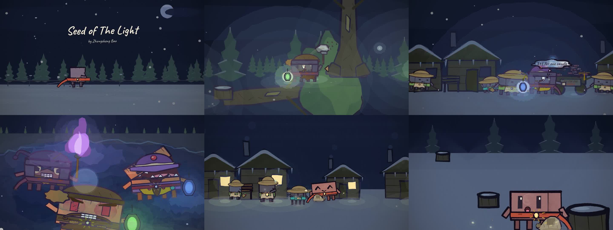
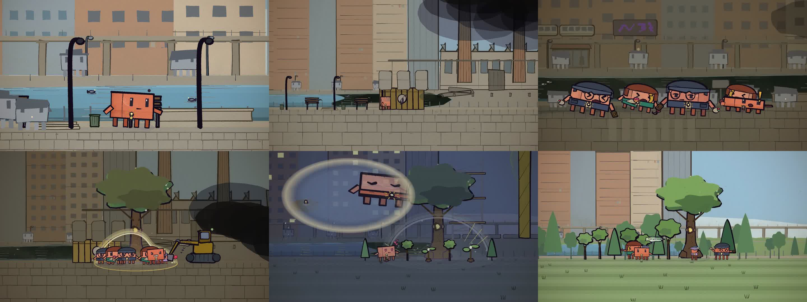

# CodeAnimation

**用纯代码画动画，而不是用扩散模型生成画面。**

这里存放的是一套手绘风 2D 动画引擎，以及用它做出来的作品。引擎与作品分开：引擎不认识任何一部片子的剧情，每一部作品只是"一个场景文件 + 一个入口 html + 一段配置"。

> Repository description: *Creating animations with pure coding instead of any diffusion model.*

---

## 作品

| 作品 | 长度 | 规格 | 状态 |
|---|---|---|---|
| **《Seed of The Light》**（两部连映：《雪夜灯火》+《最后一棵树》） | 8′09″ | 1920×1080 @ 24 fps，11 732 帧 | 处女座 · 已完成 |
| **《Whisper Of Hope》** | 2′34″ | 同引擎早期作品 | 场景文件保留为参考实现 |

### 《Seed of The Light》

一部关于"栽树"与"乘凉"的两联画。第一部是北方的雪村：三种诱饵之光（紫火把、蓝提灯、绿灯笼）与一支真正给出的蜡烛；一个人在被砍秃的桩地上埋下一粒种子。第二部跳到未来：河死了，而那粒种子长成的树还在。

第一部 ·《雪夜灯火》——片名、奸商的蓝提灯、冰湖下的三张坏脸：



第二部 ·《最后一棵树》——死河、光穹，以及恢复后的林子：



> **完整正片**：8′09″ / 1080p 的文件是 577 MB，超过 GitHub 的单文件上限（仓库 100 MB、Release 200 MB），
> 所以不放仓库里。观看入口见 [Releases](../../releases) 与置顶 issue 中的外链。

---

## 它是怎么做出来的

**每一帧都是时间 `t` 的纯函数。** 这是整个引擎唯一不可让步的约束，其余规则都从它推出来：

- 渲染是**乱序 + 并行**的，所以全局禁用 `Math.random()`。所有纸纹、笔触扰动、姿态抖动都由 `hash(⌊t·24⌋)` 派生——同一帧在任何一次运行里都长得一模一样，可以只重渲一镜、一拍，甚至一帧。
- 手绘感不是贴图，是**笔触模拟**：`p5.brush` 负责铅笔/水彩的边缘、洇墨与纸纹。角色轮廓按节拍"沸腾"，得到动画的颤动而不是噪点。
- 剪辑点全部落在**小节线**上。步态与音乐节拍锁定（beat-locked gait），转身经关键朝向插值并带 smear。

### 技术栈

| 层 | 实现 |
|---|---|
| 绘制 | [p5.js 2.3.3](https://p5js.org/) + [p5.brush 2.2.3](https://github.com/p5brush/p5brush) · WebGL |
| 渲染 | Node.js + `puppeteer-core` 无头 Chrome，多 worker 并行出帧，可断点续渲 |
| 合成 | ffmpeg（H.264 / AAC，音轨在编码时混入） |

### 引擎结构

```
src/
  core.js        笔触与填充的统一入口（paint / inkLine / 纸纹 / 相机变换）
  clawd.js       角色系统：5 个朝向、口型·眼神·体态·受光分层、表情表、步态
  props.js       道具库：树、灯笼、火把、雪堆、光斑、光晕、贴面光……
  jobs.js        角色服装库：同一副身体穿成村民、奸商、盗贼、樵夫、圣诞老人
  timeline.js    镜头分派：把时间轴上的每个镜头接到对应场景函数
  sheets.js      模板检查表的渲染器（见 templates/）
  config.js      每部作品的时长 / BPM / 首拍偏移 / 音轨
  scenes/
    film.js      与作品无关的通用镜头助手（天空、地面、雪、字幕、转场）
    snow.js      《雪夜灯火》     tree.js  《最后一棵树》
    whisper.js   《Whisper Of Hope》
```

光照有一条硬规则：**所有光源走同一个入口**（地面光斑 / 空气辉光 / 核心光晕 / 贴面光），外圈用饱和色、只有极小核心用近白，并且"光必须落在物体上"——画面里不允许存在没照亮任何东西的光。

尺度也有一条：道具一律以**主角身高**为单位定标，形成全片统一的尺度表，所以"这栋楼是角色的几倍"在画面上就是它看起来的那个数。

---

## 快速开始

需要 Node.js 与一个可调用的 Chrome / Chromium；合成音轨需要 ffmpeg（自行安装，仓库不内置二进制）。

```bash
npm install

# 看一眼：抽若干时刻拼成接触表
node render.mjs --sheet=0,20,40,60 --out=out/sheet.jpg

# 逐帧细节：某个时间区间内的每一帧
node render.mjs --strip=239:240 --out=out/strip.jpg

# 出片：并行渲帧 → 编码（--range 单位是秒，可只渲一镜）
node render.mjs --frames --range=0:335.1 --workers=4
node render.mjs --encode --audio=assets/sacred_padded.m4a --out=out/part1.mp4
```

第二部用 `--studio=studio2.html`。

---

## 模板库 `templates/`

角色、道具、表情、朝向都不是凭空画的，而是先渲成**检查表**、人工核对过尺度与画法，再进场景。`templates/` 就是这些核对用的图：

- `characters/` — 角色卡（村民、奸商、盗贼、樵夫、城里人、孩子、圣诞老人…）、朝向表、表情表、手持物表
- `props/` — 道具分册（街具、树、生活物、冷光暖光对照、事件微动作…）

每张表上的格子都站着一只"一个主角高"的灰色参考角色，所以比例可以直接读出来。

---

## 再加一部作品

引擎不为任何一部片子写死。新增一部只需要三步：

1. 写一个场景文件 `src/scenes/<work>.js`，用 `timeline.js` 的分派接口把镜头接到场景函数上；
2. 复制一个入口 html（`studio.html` 是最小样板），设好 `window.PART` 并只加载这一个场景文件；
3. 在 `src/config.js` 里为这个 `PART` 加一条 `{ duration, bpm, offset, audio }`。

`clawd.js` / `props.js` / `jobs.js` / `core.js` 不需要改动。如果新的画法确实需要新道具或新表情，加进库里——**库会因为新作品而变厚，这是设计意图**。

---

## 文档 `docs/`

| 文件 | 内容 |
|---|---|
| `MV_WORKFLOW.md` | 从一首歌到一支成片的完整工序（写给执行者，含闸门与验收标准） |
| `ANIMATION_GUIDE.md` | 动画语言与引擎 API 的规则集：构图、光、尺度、连续性、什么算 bug |
| `SCRIPT_V3.md` | 《Seed of The Light》分镜剧本 |
| `STORYBOARD.md` | 分镜表 |

---

## 关于 AI 的角色

这部片子里 **AI 没有画过任何一个像素**——画面全部由代码实时绘制，没有任何扩散模型或视频生成模型参与。

AI 承担的是制作组的工作：把口头意见翻译成可执行的代码改动、按剧本逐镜生成场景、并行渲帧、在指定帧上做取证比对、维护问题清单。文化立意、美术判断和每一轮的观片取舍由人完成。

一条纪律贯穿始终：**任何"已修复"的结论必须由成片帧证明，不许凭 diff 声称。** 这条规矩拦下过不少错误诊断——比如"灯没有大光晕"，第一版去加光晕层数，真因却是光晕圆心算到了灯体之外，画出来是一盏灯下面飘着一颗球。

---

## 授权

代码与文档采用 MIT 许可证，见 [LICENSE](LICENSE)。

片中字体为 Google Fonts 下的 Caveat、Patrick Hand、Homemade Apple（SIL Open Font License），位于 `assets/fonts/`。

© Zhongzheng Bao
