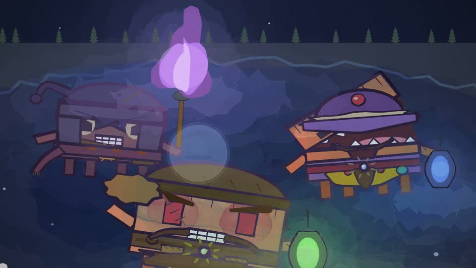
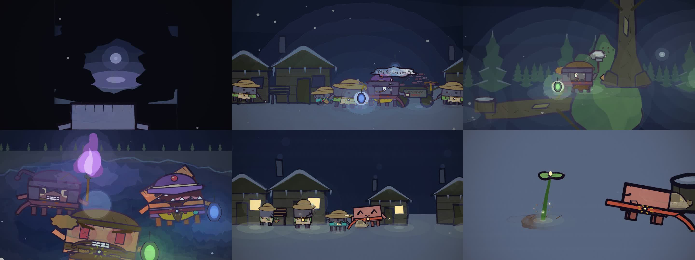
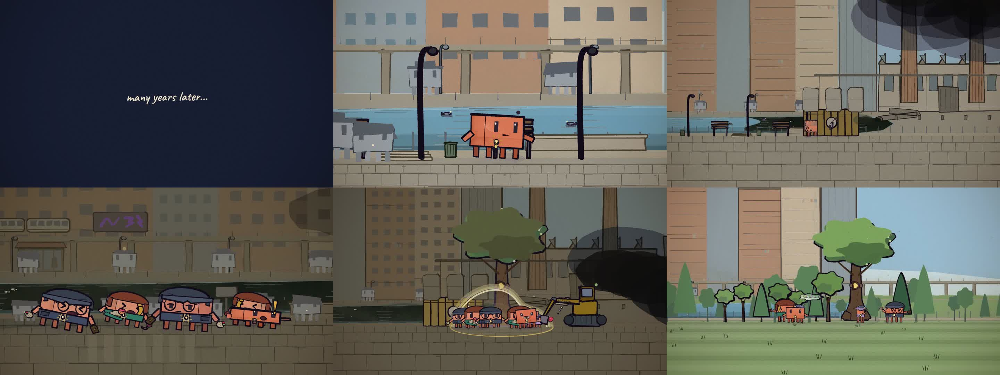
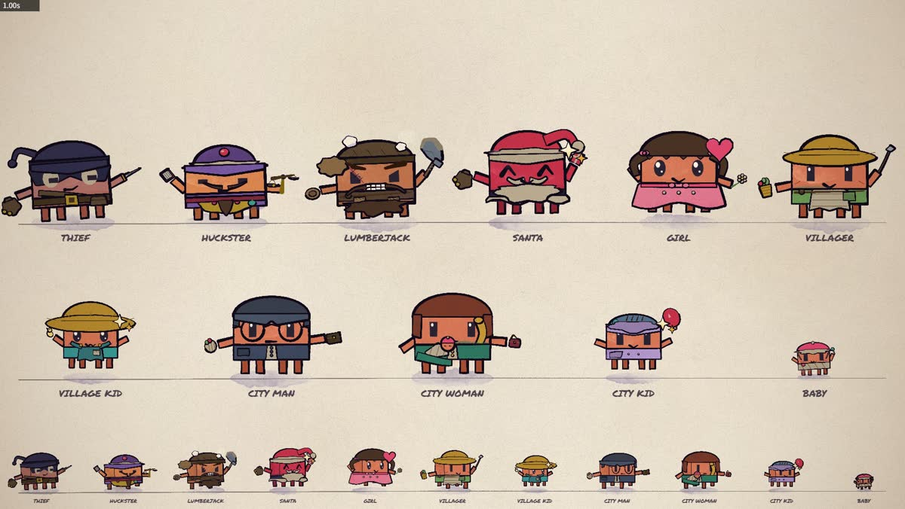
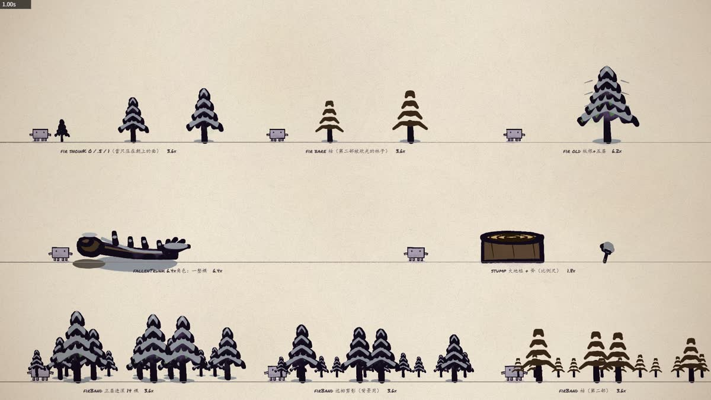

# CodeAnimation

A hand-painted 2D animation engine, and the films made with it.

No diffusion model, no image generator: every pixel is painted at render time by a p5.brush
stroke engine. Alongside the renderer sits a character system — one body, rigged for five views,
an expression table, beat-locked gaits — and a prop library that any new film draws from.

## What is here

- **The engine** — `src/core.js`, `render.mjs`: stroke primitives, paper texture, camera, a
  headless parallel frame renderer
- **The character** — `src/clawd.js`, `src/jobs.js`: one rig, dressed as a cast of twelve
- **The prop library** — `src/props.js`: trees, lanterns, torches, snow, light pools, face light
- **The template sheets** — `templates/`: every asset rendered on a measuring chart before use
- **The films** — `src/scenes/`: each one a scene file, an entry page and a config row

## Works

| # | Title | Runtime | Frames |
|---|---|---|---|
| 01 | **Seed of The Light** — a short film in two parts | 8′09″ | 11,732 |

More follow. The engine is not written to any one of them.

---

## 01 · Seed of The Light

*8 min 09 s · 1920×1080 @ 24 fps · 11,732 frames*

A light-bringer crosses a starving snow village and meets three men who sell light as bait — a
violet torch, a blue lantern, a green lamp. On the stump-field where the forest used to be, he
buries the one thing he has left. Years later, a city has grown up around the tree it became.

**Part One — Lanterns on a Snowy Night**

**Part Two — The Last Tree**

Watch: <https://www.bilibili.com/video/BV1ahp96cEND/>

---

## The library

Nothing in these films is drawn freehand on the fly. Every character, prop and expression is
rendered onto a chart first, with a grey reference Clawd standing one protagonist tall in each
cell — so scale is read off the sheet, not guessed on set.

**The cast** — twelve roles on one body:

**Props**, sized against the same reference figure:

The full set is in [`templates/`](templates).

## How it works

**Every frame is a pure function of `t`.** That one rule implies the rest of the engine: frames
render out of order and in parallel, so `Math.random()` is banned outright — paper grain, stroke
wobble and body tremor all derive from `hash(floor(t*24))`. Any frame can be re-rendered alone,
which is why fixing one shot costs one shot and not one film.

The hand-drawn look is not a texture. p5.brush simulates pencil and watercolour edges, bleed and
grain, and outlines "boil" on the beat: animation tremor, not noise. Cuts land on bar lines and
walk cycles are locked to the music.

Light obeys one rule — every source goes through the same entry point and must fall on something.
No light in these films illuminates nothing.

## Layout

    src/
      core.js        stroke + fill primitives, paper texture, camera transform
      clawd.js       the character: 5 views, mouth/eye/posture/light layers, expressions, gait
      props.js       prop library: trees, lanterns, torches, snow, glows, face light
      jobs.js        costumes: one body, dressed as villager, huckster, thief, lumberjack, santa
      timeline.js    maps each shot on the time axis to a scene function
      config.js      per-film duration / bpm / first beat / audio
      scenes/
        film.js      film-agnostic helpers: sky, ground, snow, captions, transitions
        snow.js      Seed of The Light, part one
        tree.js      Seed of The Light, part two
    render.mjs       headless Chrome renderer: contact sheets, frame batches, encode
    templates/       the measuring sheets every asset was checked against
    stills/          frames from the finished films

## Quick start

    npm install        # p5, p5.brush, puppeteer-core  (needs Chrome; ffmpeg on PATH to encode)

    node render.mjs --sheet=0,20,40,60 --out=out/sheet.jpg     # look at some moments
    node render.mjs --strip=239:240 --out=out/strip.jpg        # every frame in a stretch
    node render.mjs --frames --range=0:335.1 --workers=4       # render frames (resumable)
    node render.mjs --encode --out=out/part-one.mp4            # frames -> mp4

Pass `--studio=studio2.html` for the second half of this film, and `--audio=<file>` to `--encode`
to mux sound.

## Making a new film

1. Write a scene file in `src/scenes/` and hook its shots up through `timeline.js`.
2. Copy an entry page, set `window.PART`, and load only your scene file.
3. Add a `{ duration, bpm, offset, audio }` row for that `PART` in `src/config.js`.

`core`, `clawd`, `props` and `jobs` stay untouched. If a new film needs a new prop or expression,
it goes into the library — the library is meant to grow.

## Docs

- `docs/ANIMATION_GUIDE.md` — the rule set: composition, light, scale, continuity, what counts as a bug
- `docs/MV_WORKFLOW.md` — the end-to-end process from a song to a finished film
- `docs/SCRIPT_V3.md` — shot-by-shot script of *Seed of The Light*

## Credits

Animated by **Zhongzheng Bao**. The engine builds on
[ClaudeAnimationBase](https://github.com/JohnHeibel/ClaudeAnimationBase) by John Heibel; both are
MIT licensed, see [LICENSE](LICENSE). Fonts are Caveat, Patrick Hand and Homemade Apple (SIL OFL),
in `assets/fonts/`.
